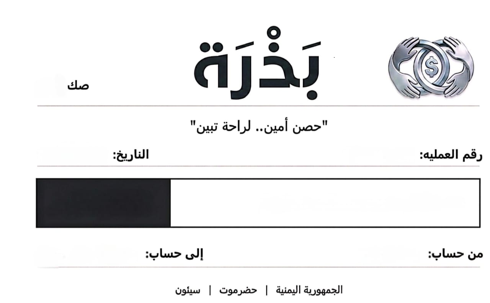
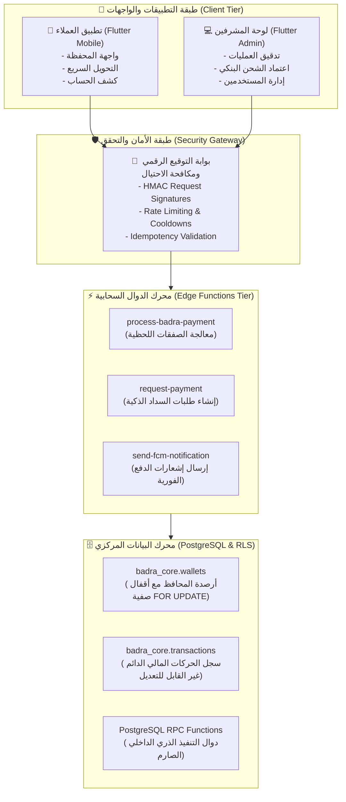
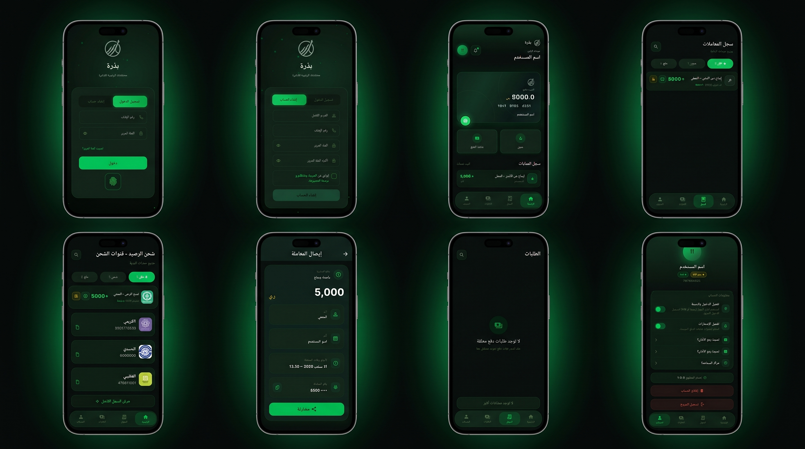
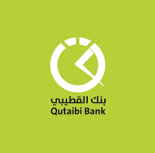

<div align="center">

  

  # بَـذْرَة | BADRA PLATFORM
  ### المنظومة المالية الرقمية المتكاملة لإدارة المحافظ، المدفوعات اللحظية، والتدقيق المالي
  **Next-Generation Digital Wallet & Enterprise Financial Operations Platform**

  <p align="center">
    <a href="#-معمارية-المنظومة-الموحدة-monorepo-architecture"></a>
    <a href="#-تطبيق-العملاء-customer-app"></a>
    <a href="#-محرك-الباك-إند-supabase-backend"></a>
    <a href="#-الأمان-المعماري-security-first"></a>
    <a href="#-الترخيص-license"></a>
  </p>

  <p align="center">
    <a href="#-مصفوفة-المنظومة-وروابط-التحميل-السريع"><b>المصفوفة والتحميل</b></a> •
    <a href="#-معمارية-المنظومة-الموحدة-monorepo-architecture"><b>الهيكلية الهندسية</b></a> •
    <a href="#-معرض-الشاشات-الحية-visual-showcase"><b>معرض الشاشات</b></a> •
    <a href="#-محرك-الباك-إند-supabase-backend"><b>الباك إند وقاعدة البيانات</b></a> •
    <a href="#-دليل-التشغيل-السريع-quickstart"><b>دليل التشغيل</b></a>
  </p>

</div>

---

## 🌟 نظرة عامة (Overview)

منظومة **بَـذْرَة (Badra Platform)** هي منصة تقنية مالية (FinTech) مؤسسية متكاملة تهدف إلى رقمنة وتسريع عمليات الدفع، التحويل اللحظي، وإدارة المحافظ الرقمية بكفاءة فائقة وموثوقية عالية.

تم بناء النظام وفق معمارية **(Monorepo)** ليحتضن التطبيقات الثلاثة في بيئة عمل واحدة مترابطة:
1. **تطبيق العملاء (`customer-app`):** تجربة مستخدم سلسة وفورية لإدارة الرصيد، سداد المشتريات، والشحن عبر مختلف الشبكات والبنوك.
2. **لوحة تحكم المشرفين (`admin-portal`):** لوحة عمليات مكتبية وميدانية متطورة للمطابقة المالية، اعتماد الحوالات، وكشف محاولات الاحتيال آلياً.
3. **محرك الباك إند المركزي (`backend`):** دوال سحابية فائقة السرعة على `Supabase Edge Functions` مع قاعدة بيانات `PostgreSQL` محصنة بسياسات أمان صفية صارمة (RLS).

---

## 🚀 مصفوفة المنظومة وروابط التحميل السريع (Ecosystem Matrix)

| التطبيق / المكون | المنصة | التقنيات | الدور الوظيفي الرئيسي | الوصول / التحميل |
| :--- | :--- | :--- | :--- | :---: |
| **تطبيق العملاء** <br>`apps/customer-app` | Android • iOS • Web | `Flutter`, `Provider`, `Supabase Flutter` | واجهة المستخدم النهائية للدفع، تحويل الأموال، سجل العمليات، وإشعارات الحوالات | 📲 **[تحميل تطبيق الزبائن (APK)](https://github.com/manafalameri/badra/releases)** |
| **لوحة تحكم المشرفين** <br>`apps/admin-portal` | Web • Windows • macOS | `Flutter Web/Desktop`, `DataGrid`, `Charts` | إدارة الطلبات، تدقيق الإيصالات، اعتماد الشحن اليدوي، إحصائيات التدفق المالي | 💻 **[معاينة لوحة الإدارة](./apps/admin-portal)** |
| **محرك الباك إند وقاعدة البيانات** <br>`backend/` | Cloud Serverless | `Supabase`, `PostgreSQL`, `Deno Edge Functions` | الصفقات الذرية (ACID)، دوال الـ RPC المشفرة، محرك الأمان RLS، والتكامل البنكي | ⚙️ **[دليل تشغيل السيرفر](./backend/SUPABASE_SETUP.md)** |

---

## 🏗️ معمارية المنظومة الموحدة (Monorepo Architecture)



---

## 📸 معرض الشاشات الحية (Visual Showcase)

<div align="center">
  
</div>

---

## 🏦 التوافق والتكامل البنكي الميداني (Integrated Banking Network)

تم تصميم النظام ليتكامل مع البنية التحتية للحوالات والشبكات المصرفية اليمنية الأكثر انتشاراً:

<div align="center">
  <table>
    <tr>
      <td align="center"><b>بنك الكريمي للتمويل الأصغر</b></td>
      <td align="center"><b>بنك القطيبي الإسلامي</b></td>
      <td align="center"><b>شركة البسيري للصرافة</b></td>
      <td align="center"><b>شركة العمقي وإخوانه</b></td>
    </tr>
    <tr>
      <td align="center"></td>
      <td align="center"></td>
      <td align="center"></td>
      <td align="center"></td>
    </tr>
  </table>
</div>

---

## 🛡️ المبادئ الهندسية والأمان المالي (Core Engineering Principles)

1. **الأمان في قاعدة البيانات أولاً (Database-First Security):**
   * واجهات التطبيقات لا تقوم بإجراء أي استعلامات تعديل أو كتابة مباشرة على جداول الأرصدة.
   * كافة العمليات تتم حصراً عبر استدعاء دوال خادم معتمدة (`PostgreSQL RPC Functions`) تعمل بصلاحية `SECURITY DEFINER` ومسار بحث محصن (`SET search_path = public, badra_core`).
2. **منع تضارب العمليات المتزامنة (Race Conditions Protection):**
   * استخدام الأقفال الصفية المشروطة (`SELECT ... FOR UPDATE`) لضمان صحة رصيد المحفظة عند تلقي مئات العمليات في نفس الجزء من الثانية.
3. **مفاتيح عدم التكرار (Idempotency Keys):**
   * منع تكرار خصم أو قيد أي مبلغ في حال تكرار الضغط على الزر أو انقطاع شبكة الهاتف المحمول أثناء الدفع.
4. **سجل تدقيق مالي غير قابل للتعديل (Immutable Audit Ledger):**
   * تسجيل كل حركة مالية مع بصمتها الرقمية ومعرف الإيصال وتاريخ الإيداع للمطابقة المحاسبية.

---

## 🛠️ دليل التشغيل السريع للمطورين (Quickstart Guide)

### 1. استنساخ المشروع:
```bash
git clone https://github.com/manafalameri/badra.git
cd badra
```

### 2. تهيئة وتشغيل الباك إند (Supabase):
راجع الدليل المفصل في: [**`backend/SUPABASE_SETUP.md`**](./backend/SUPABASE_SETUP.md) لتجهيز الخادم بضغطة زر واحدة عبر:
```bash
cd backend
supabase link --project-ref your-project-id
supabase db push
supabase functions deploy
```

### 3. إعداد متغيرات البيئة:
قم بنسخ ملف الإعدادات النموذجي:
```bash
cp .env.example .env
```
وقم بملء رابط `SUPABASE_URL` ومفتاح `SUPABASE_ANON_KEY`.

### 4. تشغيل تطبيق العملاء:
```bash
cd apps/customer-app
flutter pub get
flutter run
```

### 5. تشغيل لوحة المشرفين:
```bash
cd apps/admin-portal
flutter pub get
flutter run -d chrome
```

---

## 👨‍💻 المهندس المعماري والمطور (Author & Lead Architect)

**المهندس مـنـاف الـعـامـري (Mnaf Alamri)**  
* مطور برمجيات متكامل (Full-Stack & Mobile Solutions Engineer).
* **GitHub:** [@manafalameri](https://github.com/manafalameri)  
* **معرض الأعمال:** [manaf-alamri.vercel.app](https://manaf-alamri.vercel.app/)  
* **البريد الرسمي:** `mnafalamry05@gmail.com`

---

## 📜 الترخيص (License)
هذا المشروع مرخص بموجب رخصة [MIT License](./LICENSE).
